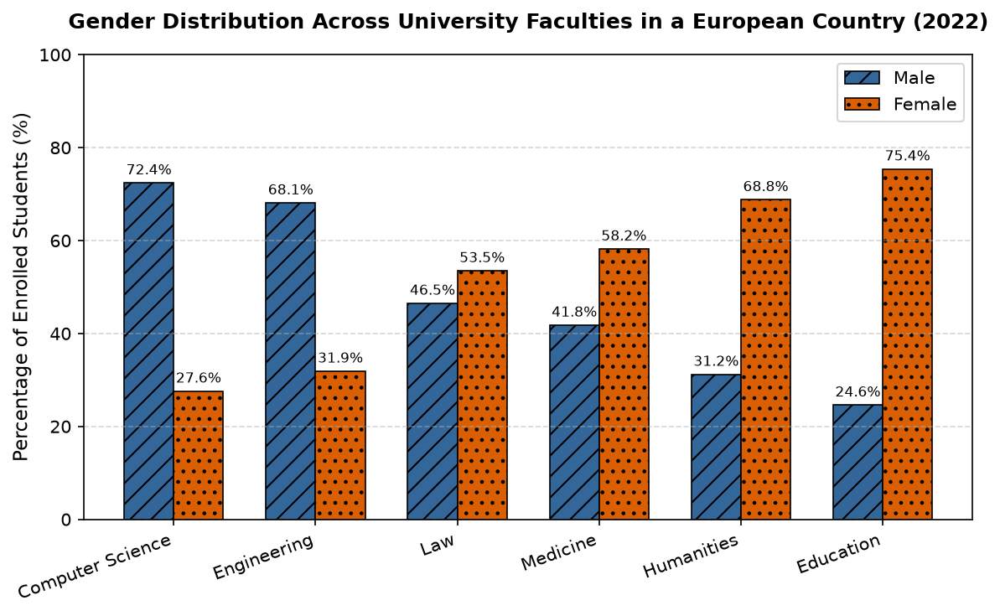

# IELTS Academic Writing Complete Section 1

**Total Suggested Time:** 60 minutes  
- **Task 1:** ~20 minutes (at least 150 words)  
- **Task 2:** ~40 minutes (at least 250 words)

---

## Task 1: Academic Report (Bar Chart)

> **The chart below shows the percentage of male and female students enrolled in six different university faculties in a European country in 2022.**
> 
> **Summarise the information by selecting and reporting the main features, and make comparisons where relevant.**

Write at least **150 words**.

---

## Task 2: Academic Essay (Discussion)

> **Some people believe that artificial intelligence (AI) will replace human employees in many professions, leading to widespread unemployment. Others argue that AI will create more new job opportunities and enhance overall productivity.**
> 
> **Discuss both views and give your own opinion.**

Give reasons for your answer and include any relevant examples from your own knowledge or experience.

Write at least **250 words**.
