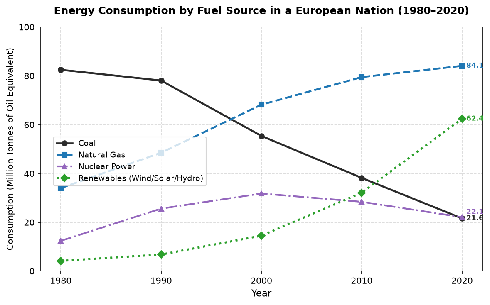

# IELTS Academic Writing Task 1

You should spend about **20 minutes** on this task.

> **The graph below shows the consumption of four different energy sources in a European country from 1980 to 2020.**
> 
> **Summarise the information by selecting and reporting the main features, and make comparisons where relevant.**

Write at least **150 words**.

---

### Data Table for Verification (Million Tonnes of Oil Equivalent - Mtoe)

| Energy Source | 1980 | 1990 | 2000 | 2010 | 2020 |
| :--- | :--- | :--- | :--- | :--- | :--- |
| **Coal** | 82.5 | 78.1 | 55.4 | 38.2 | 21.6 |
| **Natural Gas** | 34.0 | 48.5 | 68.2 | 79.5 | 84.1 |
| **Nuclear Power** | 12.4 | 25.6 | 31.8 | 28.4 | 22.1 |
| **Renewables** | 4.2 | 6.8 | 14.5 | 32.1 | 62.4 |

