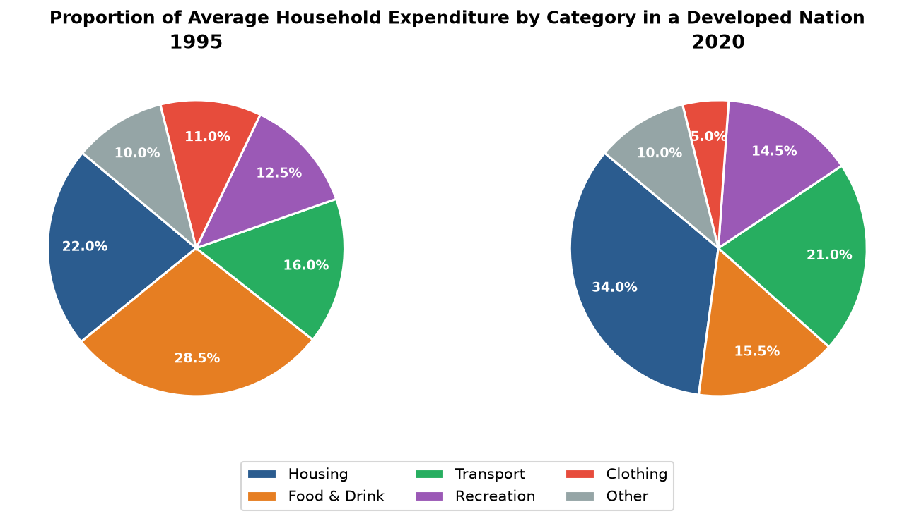

# IELTS Academic Writing Task 1

You should spend about **20 minutes** on this task.

> **The pie charts below show the proportion of average household expenditure across six categories in a developed nation in 1995 and 2020.**
> 
> **Summarise the information by selecting and reporting the main features, and make comparisons where relevant.**

Write at least **150 words**.

---

### Data Table for Verification (%)

| Category | 1995 (%) | 2020 (%) |
| :--- | :--- | :--- |
| **Housing** | 22.0% | 34.0% |
| **Food & Drink** | 28.5% | 15.5% |
| **Transport** | 16.0% | 21.0% |
| **Recreation** | 12.5% | 14.5% |
| **Clothing** | 11.0% | 5.0% |
| **Other** | 10.0% | 10.0% |

